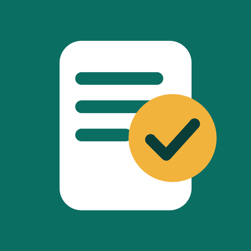
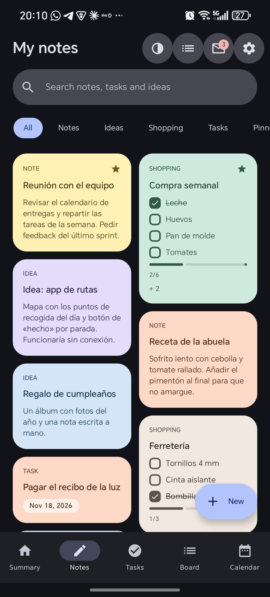
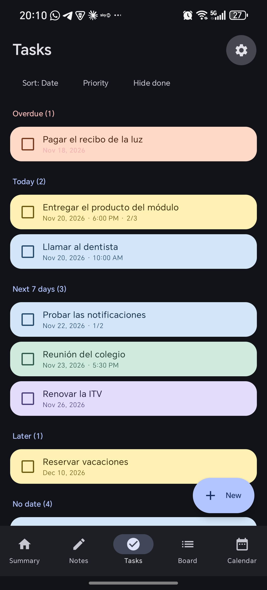
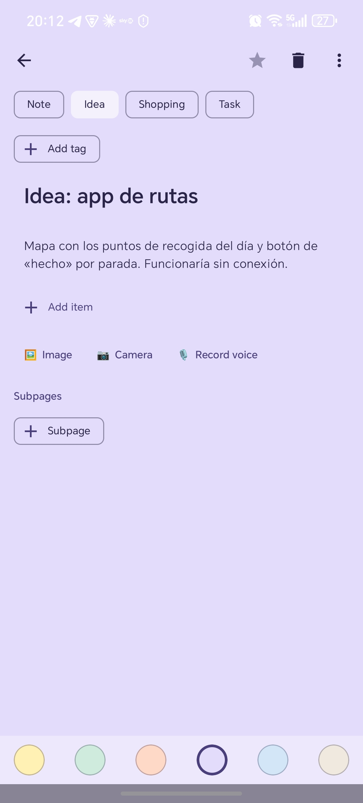
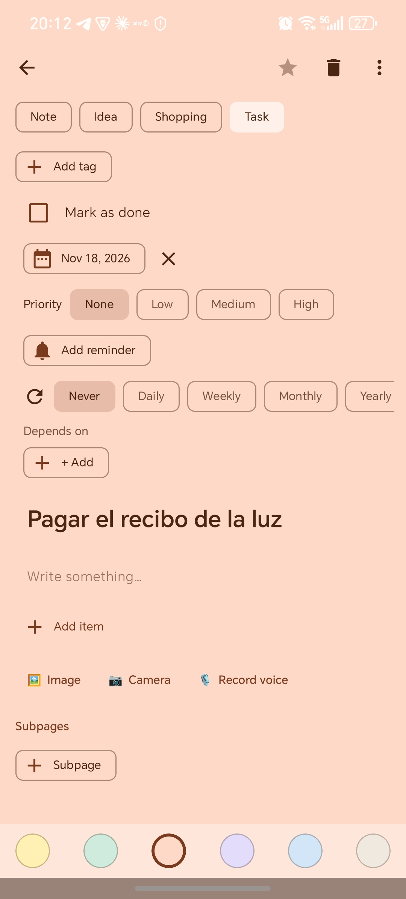
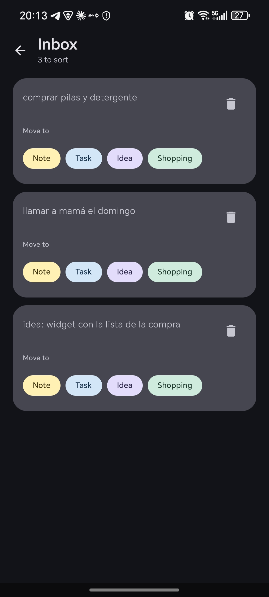

<div align="center">



# Bloc de notas

**Notes, tasks, ideas, shopping lists, a Trello-style board and a calendar in one Android app.**
Built for jotting things down instantly from your home screen. Free software, no ads, no accounts, offline by default.

[Español](README.md)

</div>

<p align="center">
  
  
  
  
  
</p>

## Features

- **Notes, ideas and shopping lists**: checklists, colors, pinned notes, labels, search, templates, `[[links]]` between notes and `/` commands
- **Shopping mode**: big rows, screen kept on, items grouped by aisle, highlighted quantities ("2 kg rice")
- **Tasks**: due date, reminder time, priority, labels, repeat and task dependencies
- **Board**: Trello-style kanban, **one board per project**, columns, subtasks and drag and drop
- **Calendar**: month, agenda and timeline views with dependencies; holidays and saints' days
- **Dashboard**, **saved views**, light/dark/Material You themes, Spanish and English
- **Attachments**: images (gallery or camera) and voice notes
- **Widgets**: quick capture (with voice), task list, agenda and pinned notes
- **Data**: ZIP backup, Markdown/JSON export, import from Google Keep and Todoist, optional WebDAV/Nextcloud sync

## Privacy and security

No accounts, ads or analytics. Everything stays on your device. The internet permission is only used by the optional WebDAV sync (https only, off by default). Android cloud backup is disabled. Optional fingerprint lock. See [SECURITY.md](SECURITY.md) to report a vulnerability.

## Install

F-Droid (publication in progress, see [docs/FDROID.md](docs/FDROID.md)) or APKs from [Releases](../../releases).

## Build

JDK 17 and the Android SDK (compileSdk 35, minSdk 26):

```bash
git clone https://github.com/estebangoco-alt/Bloc-de-notas.git
cd Bloc-de-notas
./gradlew assembleDebug
./gradlew test
```

Built with Kotlin, Jetpack Compose, Room and Glance. All dependencies are free software (F-Droid inclusion policy). See [docs/ARCHITECTURE.md](docs/ARCHITECTURE.md) (Spanish) and [CONTRIBUTING.md](CONTRIBUTING.md).

## License

GNU GPL v3 or later. See [LICENSE](LICENSE).
