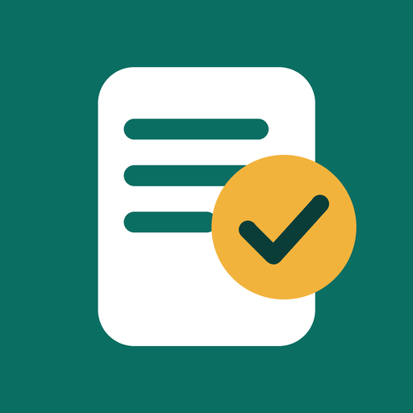
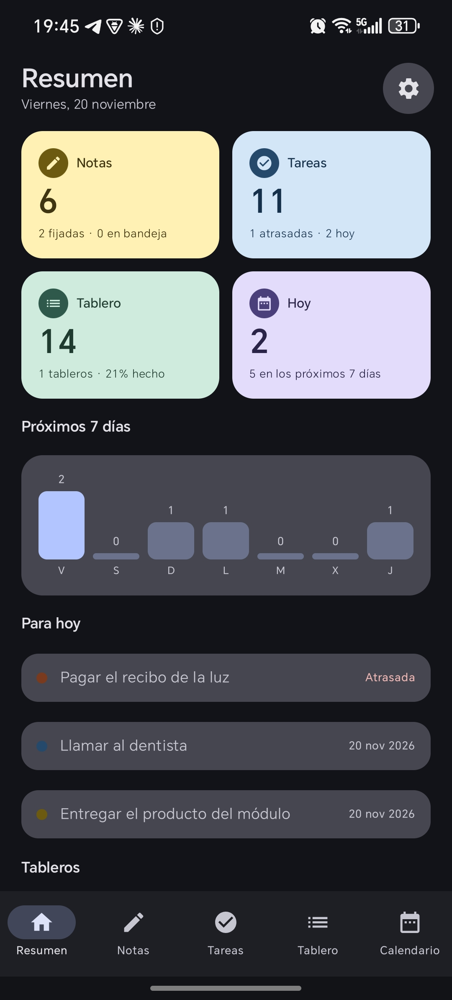
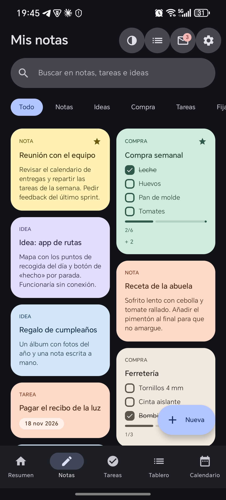
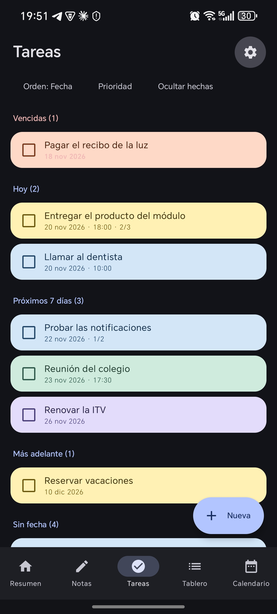
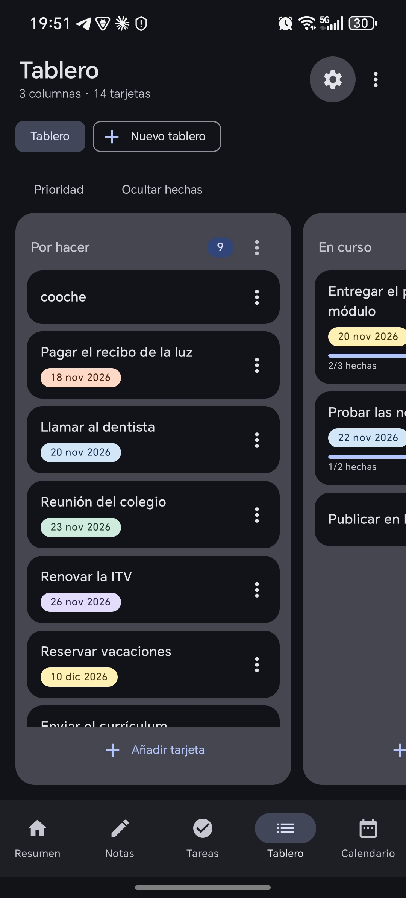
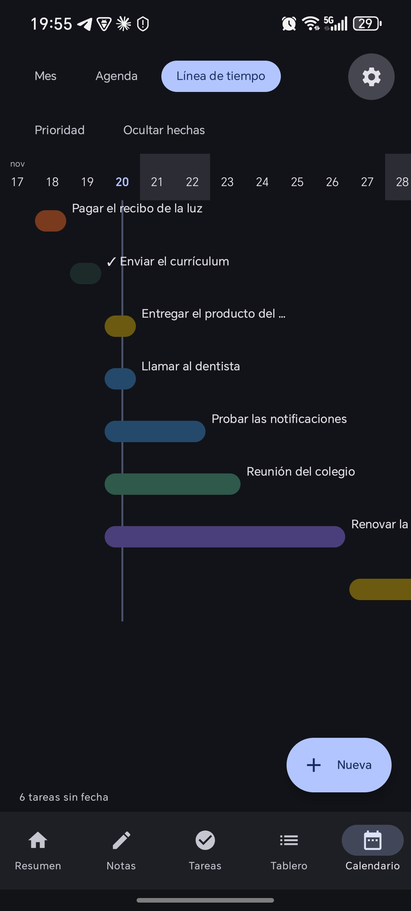

<div align="center">



# Bloc de notas

**Notas, tareas, ideas, lista de la compra, tablero tipo Trello y calendario en una sola app para Android.**
Pensada para apuntar al instante desde la pantalla de inicio. Software libre, sin anuncios, sin cuentas y sin conexión por defecto.

[](LICENSE)


[](../../actions/workflows/ci.yml)

[English](README.en.md) · [Hoja de ruta](docs/ROADMAP.md) · [Cambios](CHANGELOG.md) · [Contribuir](CONTRIBUTING.md) · [Seguridad](SECURITY.md)

</div>

<p align="center">
  
  
  
  
  
</p>

## Índice

[Por qué existe](#por-qué-existe) · [Características](#características) · [Widgets](#widgets) · [Privacidad y seguridad](#privacidad-y-seguridad) · [Datos: copia, exportar, importar y sincronizar](#datos-copia-exportar-importar-y-sincronizar) · [Instalación](#instalación) · [Compilar](#compilar-desde-el-código) · [Tecnología](#tecnología) · [Estructura](#estructura-del-repositorio) · [Contribuir](#contribuir) · [Licencia](#licencia)

## Por qué existe

Entre las apps libres de F-Droid hay buenas apps de notas y buenas apps de tareas, pero ninguna que junte en una sola, y de forma totalmente local:

- notas, ideas y listas de la compra,
- tareas con fecha y recordatorios,
- tablero kanban,
- calendario,
- widgets de captura instantánea.

Los tableros kanban libres suelen necesitar un servidor propio. Esta app guarda todo en el móvil.

## Características

| | |
|---|---|
| 🗒️ **Notas, ideas y compra** | Texto y listas con casillas, colores, fijadas, etiquetas, búsqueda, plantillas (también propias), enlaces `[[Título]]`, subpáginas y comandos con `/` |
| 🛒 **Modo compra** | Filas grandes, pantalla encendida, artículos por pasillo y cantidades destacadas («2 kg arroz») |
| ✅ **Tareas** | Fecha, hora de aviso, prioridad, etiquetas, repetición, dependencias entre tareas y recordatorios |
| 🗂️ **Tablero** | Kanban estilo Trello, **un tablero por proyecto**, columnas editables, subtareas y arrastrar tarjetas |
| 📅 **Calendario** | Mes, agenda y línea de tiempo con dependencias; festivos por comunidad y santos |
| 📊 **Resumen** | Panel con los números de las cuatro secciones, tareas de hoy y atrasadas y avance de cada tablero |
| 🎙️ **Adjuntos** | Imágenes (galería o cámara) y notas de voz en cada nota |
| 👁️ **Vistas guardadas** | Orden y filtros guardados en Notas, Tareas, Tablero y Calendario |
| 🎨 **Aspecto** | Tema claro, oscuro y Material You; castellano e inglés |

<details>
<summary>Lista completa de funciones</summary>

- Widget de captura rápida con elección de destino, prioridad y micrófono
- Bandeja de entrada para lo capturado sin clasificar
- Compartir texto desde otras apps hacia la bandeja
- Recordatorios con notificación (se reprograman al reiniciar el móvil)
- Plantillas: compra semanal, reunión, proyecto y diario
- Papelera de 30 días y bloqueo con huella, cara o bloqueo de pantalla
- Exportar a Markdown y a JSON; copia de seguridad ZIP
- Importar desde Google Keep y Todoist
- Sincronización opcional con WebDAV / Nextcloud
- Datos de ejemplo para probar la app (Ajustes)

</details>

## Widgets

Al añadir un widget en la pantalla de inicio aparecen cuatro, cada uno con su nombre:

| Widget | Para qué sirve |
|---|---|
| **Captura rápida** (4×1) | Escribir o dictar una nota al instante; elige destino y, en las tareas, la prioridad |
| **Lista de tareas** (3×3) | Tus tareas pendientes, las que tienen fecha primero |
| **Agenda** (3×3) | Próximas tareas con fecha y las atrasadas |
| **Notas fijadas** (3×3) | Tus notas fijadas, a un toque |

Tocar una fila abre esa nota. Los widgets de lista se actualizan solos cuando cambian las notas.

## Privacidad y seguridad

- Sin cuentas, sin anuncios y sin analítica. Todos los datos se guardan en el dispositivo.
- `allowBackup="false"`: Android no copia tus notas a la nube de Google.
- Permisos mínimos: micrófono (solo al grabar), internet (solo con la sincronización activada, solo `https`), notificaciones, alarmas exactas (recordatorios), arranque (reprogramar avisos) y biometría (bloqueo opcional). La cámara no necesita permiso.
- Con el bloqueo activado, la app no sale en capturas ni en las apps recientes.
- Imágenes y audios en el almacenamiento privado de la app.
- Para avisar de un fallo de seguridad, lee [SECURITY.md](SECURITY.md).

## Datos: copia, exportar, importar y sincronizar

Todo en **Ajustes**, sin permisos de almacenamiento:

- **Copia de seguridad** (`.zip` con `backup.json` y los adjuntos): exporta todo y restáurala en otro dispositivo (*Combinar* o *Reemplazar*). Formato: [`docs/BACKUP_FORMAT.md`](docs/BACKUP_FORMAT.md).
- **Exportar a Markdown**: un `.zip` con un `.md` por nota, en carpetas por tipo y con cabecera YAML.
- **Importar desde otras apps**: Google Keep (ZIP de Takeout) y Todoist (CSV de un proyecto, crea un tablero).
- **Sincronización opcional** con tu servidor WebDAV / Nextcloud: apagada por defecto.

## Instalación

- **F-Droid** (objetivo principal): en proceso de publicación. Ver [docs/FDROID.md](docs/FDROID.md).
- **APK** en la sección [Releases](../../releases) de este repositorio.

## Compilar desde el código

Requisitos: Android Studio reciente (o solo las herramientas de línea de comandos), JDK 17 y Android SDK (compileSdk 35, minSdk 26 = Android 8.0 o superior).

```bash
git clone https://github.com/estebangoco-alt/Bloc-de-notas.git
cd Bloc-de-notas
./gradlew assembleDebug   # el APK queda en app/build/outputs/apk/debug/
./gradlew test            # pruebas de la lógica
```

## Tecnología

| Área | Elección |
|---|---|
| Lenguaje | Kotlin |
| Interfaz | Jetpack Compose + Material 3 |
| Navegación | Navigation Compose |
| Datos | Room (SQLite), con migraciones y esquemas exportados |
| Copia de seguridad | kotlinx.serialization (JSON dentro de un ZIP) |
| Widgets | Jetpack Glance |
| Recordatorios | AlarmManager |
| Bloqueo | AndroidX Biometric |
| Sincronización | WebDAV con `HttpURLConnection`, sin librerías externas |
| Tests | JUnit sobre la lógica pura (repeticiones, enlaces, tablero, dependencias, importadores, copia…) |

Todas las dependencias son software libre, para cumplir la [política de inclusión de F-Droid](https://f-droid.org/docs/Inclusion_Policy). Sin Google Play Services, Firebase, anuncios ni analítica. Cómo está organizado el código: [docs/ARCHITECTURE.md](docs/ARCHITECTURE.md).

## Estructura del repositorio

```text
app/                         Código de la app Android (Kotlin + Compose)
docs/                        Arquitectura, hoja de ruta, formato de la copia y guía de publicación
scripts/                     Utilidades (p. ej. cambiar el identificador de la app)
fastlane/metadata/android/   Textos, icono y capturas para F-Droid
.github/                     Plantillas de incidencias y pull requests, y compilación automática
CONTRIBUTING.md              Guía para colaborar
SECURITY.md                  Cómo reportar vulnerabilidades
CHANGELOG.md                 Historial de cambios
LICENSE                      Licencia (GPL-3.0)
```

## Contribuir

Las ideas, los errores y las traducciones son bienvenidos. Lee [CONTRIBUTING.md](CONTRIBUTING.md) antes de abrir una incidencia o un pull request. Lo que viene después está en la [hoja de ruta](docs/ROADMAP.md).

## Licencia

Software libre bajo la licencia **GNU GPL v3 o posterior**. Consulta el archivo [LICENSE](LICENSE).

© Esteban y colaboradores.
